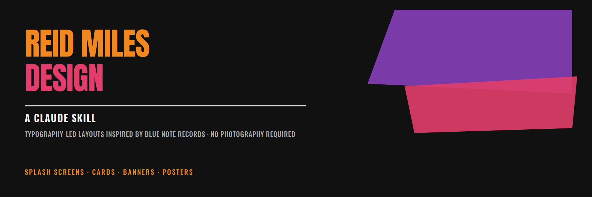
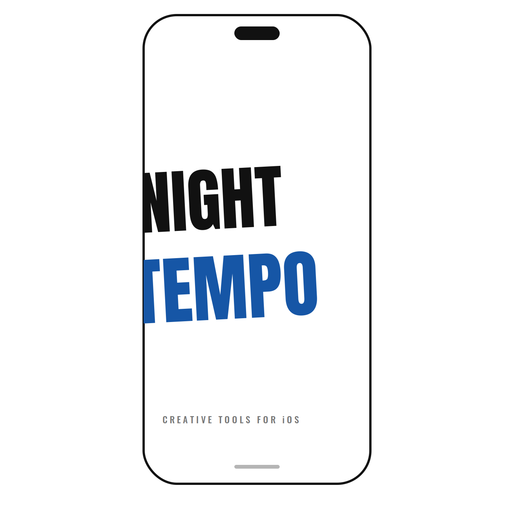
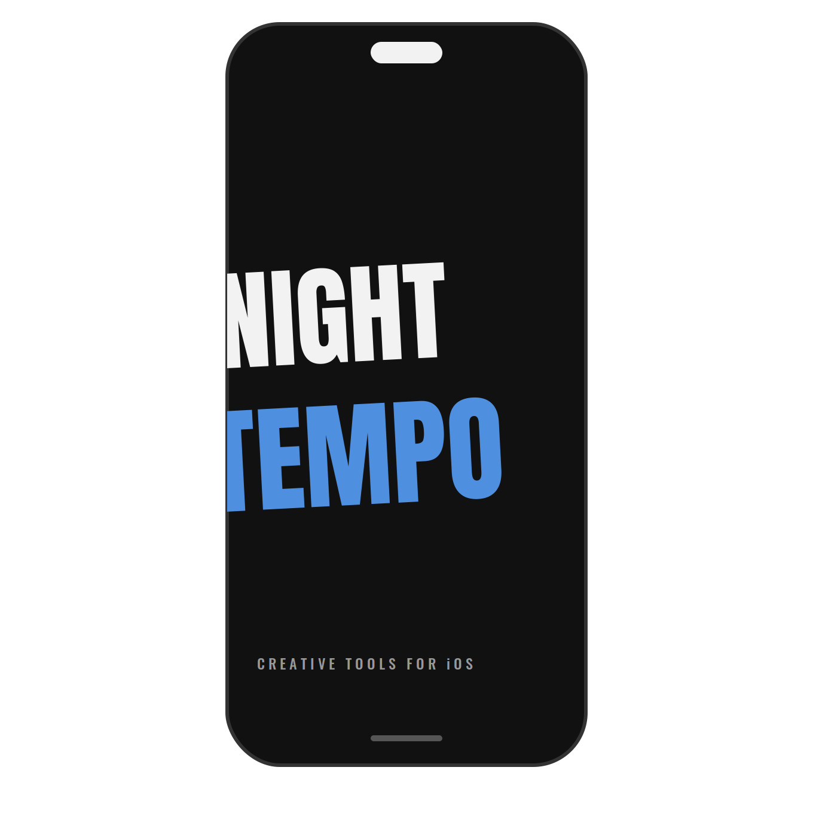
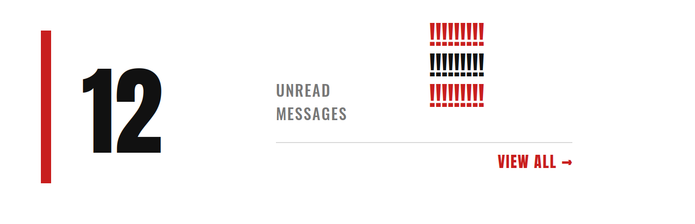
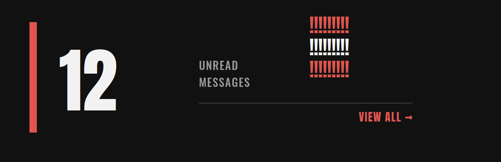
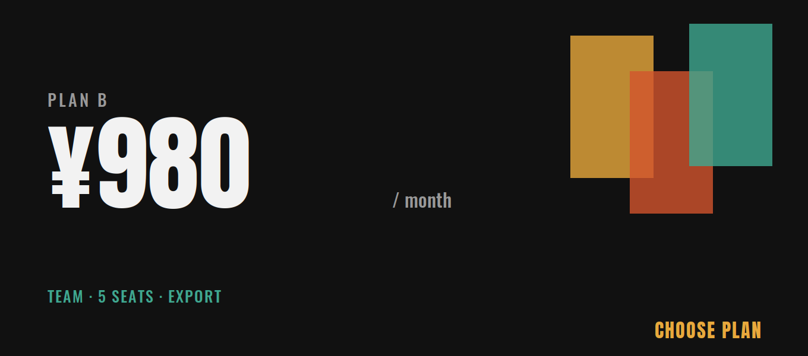
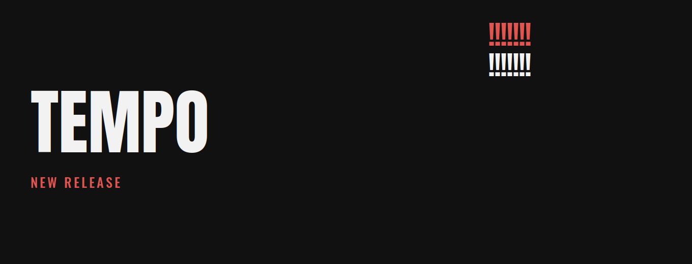
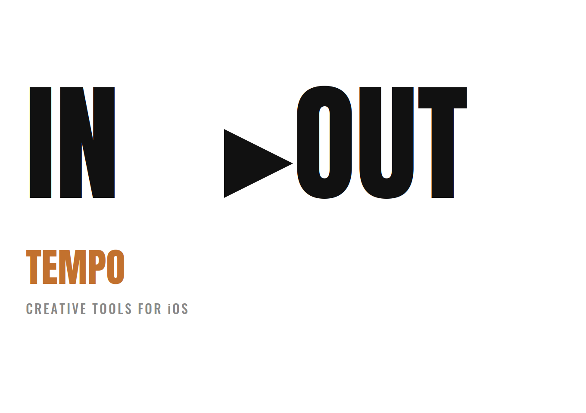
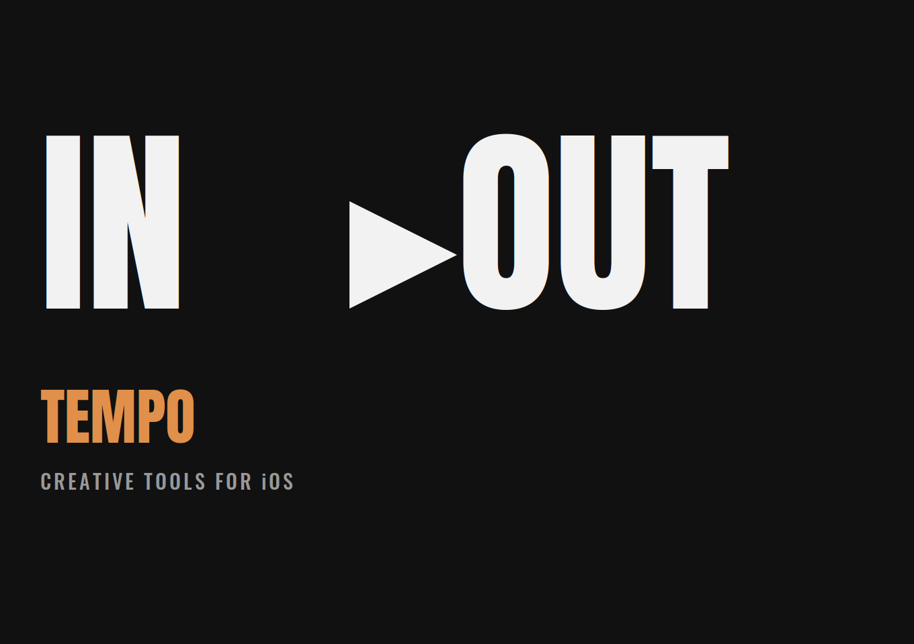

# reid-miles-design

A Claude skill for generating typography-led UIs, splash screens, banners, and cards in the style of **Reid Miles**' Blue Note Records album covers — without using photography.

Inspired by Reid Miles (1927-1993), Blue Note Records' art director from 1956 to 1967, and the Swiss / International Typographic Style that shaped his work.

## What it does

When triggered, this skill instructs Claude to produce layouts following four core principles:

1. **Typography as the lead actor** — bold, contrasting typefaces carry the design; no photography
2. **Color blocks in place of photography** — flat color fields and rules replace the tinted photography Miles usually paired with type
3. **Asymmetric, dynamic composition** — off-center layouts, elements cropped at the frame edge
4. **Rhythm through repetition and scale contrast** — extreme size jumps between dominant and supporting elements

For single-image outputs (icons, splash screens, key visuals) it adds a further layer — breaking the frame, overlapping elements, tilted baselines, non-rectangular color fields — so the result keeps Miles' "about to burst into motion" tension instead of settling into generic flat design.

## Installation

### Claude Desktop / Claude Code

Copy the `reid-miles-design` folder into your skills directory, or install the `.skill` file if packaged.

### Manual

Place the folder where your Claude configuration can reference it, and ensure `SKILL.md` is accessible as a skill.

## Trigger phrases

The skill activates on mentions of:

- Reid Miles, Blue Note Records, Blue Note style
- "Jazz album cover look but no photography"
- "Typography-only", "make it feel that way through type alone"
- Splash screens, app icons, or banners that should feel bold and typographic rather than photo-led

## Examples

All outputs below were generated by Claude using this skill. Each is modeled on a specific Reid Miles cover confirmed to use no photography, so the color and composition stay faithful to the constraint.

### Splash screen (light)

Block-letter typography only, one word tinted blue — based on Kenny Burrell's *Midnight Blue*, whose cover used only lettering (with just the word "Blue" colored) and no photograph.

### Splash screen (dark)

### Notification card (light)

A red-and-black exclamation-mark pattern behind a large number — based on Jackie McLean's *It's Time!*, whose cover (245 exclamation marks, tagged "only type" by design archive Fonts In Use) used no photography.

### Notification card (dark)

### Pricing card (light)

Overlapping colored rectangles suggesting piano keys — based on the *Jutta Hipp with Zoot Sims* cover, an abstract geometric design with sans-serif type and no photography.

### Pricing card (dark)

### Banner (light)

### Banner (dark)

### Poster / hero (light)

Oversized letterforms with an arrow motif, one word in a warm accent color — based on Joe Henderson's *In 'n Out*, one of Miles' designs described as dispensing with photography almost entirely.

### Poster / hero (dark)

## Reference files

- `references/typography.md` — common Reid Miles typefaces and how to combine them
- `references/color.md` — color patterns drawn from real, confirmed-no-photography Blue Note covers
- `references/layout.md` — composition rules, plus the additional single-image principles (breaking the frame, overlap, tilt, extreme scale contrast)

## License

MIT
